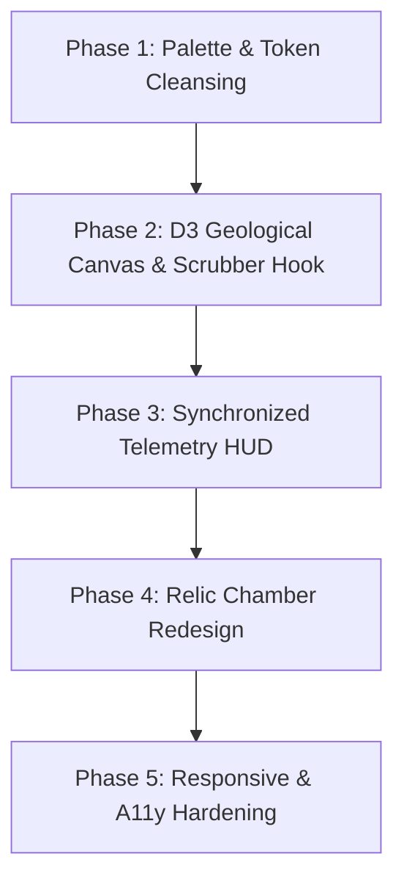

# Ship of Theseus: Comprehensive Frontend UI/UX Audit & Re-envisioning Blueprint

> **Date:** October 24, 2026  
> **Status:** Strategic UI/UX Architecture & Experience Appraisal  
> **Target:** Frontend Client (`public/index.html`, `public/style.css`, `public/chart.js`, `public/ui.js`, `public/app.js`)  
> **Verdict:** *A profound metaphysical concept reduced to a generic developer dashboard. The core data is extraordinary, but its visual representation fails to evoke the contemplative wonder of Plutarch's paradox.*

---

## Table of Contents
1. [Executive Summary & The Visual Paradox](#1-executive-summary--the-visual-paradox)
2. [The Current Reality vs. The Observatory Ideal](#2-the-current-reality-vs-the-observatory-ideal)
3. [The 5 Core Experiential & Visual Sins](#3-the-5-core-experiential--visual-sins)
   - [3.1 The Rainbow Pastry Layer Cake (Perceptual Failure of Age)](#31-the-rainbow-pastry-layer-cake-perceptual-failure-of-age)
   - [3.2 The Temporal Disconnection (Scrubber vs. Static HUD)](#32-the-temporal-disconnection-scrubber-vs-static-hud)
   - [3.3 The SaaS Metric Card Cliché (Identical Box Grid)](#33-the-saas-metric-card-cliché-identical-box-grid)
   - [3.4 The Buried Relics (Under-staged Fossils)](#34-the-buried-relics-under-staged-fossils)
   - [3.5 The SEO Intrusion & Fragmented Narrative Arc](#35-the-seo-intrusion--fragmented-narrative-arc)
4. [Detailed Subsystem Ratings & Code Audits](#4-detailed-subsystem-ratings--code-audits)
   - [4.1 Visual Hierarchy & Spatial Architecture (Rating: 5.0 / 10)](#41-visual-hierarchy--spatial-architecture-rating-50--10)
   - [4.2 Data Visualization Ergonomics & D3 Craft (Rating: 6.0 / 10)](#42-data-visualization-ergonomics--d3-craft-rating-60--10)
   - [4.3 Interaction Design, Scrubber & Real-Time Feedback (Rating: 4.5 / 10)](#43-interaction-design-scrubber--real-time-feedback-rating-45--10)
   - [4.4 Design System Rigor & Token Fidelity (Rating: 6.5 / 10)](#44-design-system-rigor--token-fidelity-rating-65--10)
   - [4.5 Accessibility, Contrast & Responsive Adaptability (Rating: 5.5 / 10)](#45-accessibility-contrast--responsive-adaptability-rating-55--10)
   - [Overall Frontend Experience Scorecard](#overall-frontend-experience-scorecard)
5. [The Re-envisioned Concept: The Metaphysical Observatory](#5-the-re-envisioned-concept-the-metaphysical-observatory)
   - [5.1 The Metaphor: Software Geology & Archaeological Strata](#51-the-metaphor-software-geology--archaeological-strata)
   - [5.2 Chromatic Aging: The Geological Palette](#52-chromatic-aging-the-geological-palette)
   - [5.3 The Synchronized Temporal HUD (The Time Machine)](#53-the-synchronized-temporal-hud-the-time-machine)
   - [5.4 The Relic Chamber: Elevating Living and Genesis Fossils](#54-the-relic-chamber-elevating-living-and-genesis-fossils)
   - [5.5 The Core Sample Tool: Interactive Strata Cross-Section](#55-the-core-sample-tool-interactive-strata-cross-section)
6. [Component-by-Component Redesign Specifications](#6-component-by-component-redesign-specifications)
7. [Phased Implementation Roadmap](#7-phased-implementation-roadmap)

---

## 1. Executive Summary & The Visual Paradox

The **Ship of Theseus** project has solved one of the hardest engineering challenges in developer telemetry: high-speed, parallel, line-level historical provenance across a decade of git commits. Its Rust engine extracts deterministic Genesis and Survivor fossils in seconds.

Yet when a user opens the webpage, what do they experience?

They are greeted by a web page that looks like **every developer portfolio and AI SaaS dashboard built since 2024**:
- A dark background with artificial noise overlay.
- A rainbow stacked area chart where 2013 code is bright turquoise and 2014 code is lavender.
- Five identical rounded rectangles asking rhetorical questions with two-digit numbers and tiny labels.
- A "Request a repository" input field jammed awkwardly in the center of the reading experience.
- Two tiny monospace grey boxes at the bottom of the page containing the most astonishing discoveries in the entire project: the surviving lines of founding code.
- A massive wall of boilerplate FAQ accordion items pasted at the footer for search engine bots.

### The Unvarnished Truth
The current frontend commits the ultimate design mistake: **it treats a philosophical inquiry into software identity as a telemetry dashboard.**

Instead of feeling like an astronomer looking through a telescope at the slow, majestic drift of stellar matter, the user feels like a DevOps engineer glancing at a Datadog monitor. The visual language contradicts the creative north star defined in `PRODUCT.md`.

---

## 2. The Current Reality vs. The Observatory Ideal

| Aspect | Current Reality | The Observatory Ideal |
| :--- | :--- | :--- |
| **Atmospheric Register** | Generic dark-mode SaaS dashboard with CSS noise. | Quiet, reverent, astronomical observatory. The data is a deep window into time. |
| **Color Semantics** | Modulo rainbow hue spin: `(195 + yearIdx * 36) % 360`. | Geological aging ramp: ancient code has the warm patina of bronze and pyrite; modern code glows with crisp glacial seafoam. |
| **Temporal Relationship** | Scrubber moves an indicator line; metric cards stay frozen at HEAD. | Full temporal synchronization: scrubbing through time rewinds all metrics, strata shares, and living fossils to that exact month. |
| **Relic Artifacts (Fossils)** | Plain grey bash boxes placed below a submission form. | Museum relic pedestals: elevated historical code fragments with diff context, line pointers, and reverent typography. |
| **Information Architecture** | Vertical stack of disjointed sections interrupted by an input form. | Unified single-canvas narrative: Observatory Bridge -> The Living Strata -> Temporal HUD -> Relic Chamber -> Epilogue. |
| **Analytical Depth** | Static percentages at HEAD (`percent-replaced`). | Interactive Core Sampling: click or hover any year stratum to isolate its lifecycle from birth to extinction. |

---

## 3. The 5 Core Experiential & Visual Sins

### 3.1 The Rainbow Pastry Layer Cake (Perceptual Failure of Age)
In [public/chart.js:51-57](file:///C:/Users/sayye/dev/active/Theseus/public/chart.js#L51-L57), the chart calculates layer fill colors using:
```javascript
const yearIdx = years.indexOf(seriesName);
return `oklch(70% 0.14 ${(195 + yearIdx * 36) % 360})`;
```
This is a fatal visual flaw. In data visualization science (Bertin, Tufte, Cleveland), **hue represents categorical identity, not ordered continuous sequences like time**.

When 2016 is magenta, 2017 is green, and 2018 is amber, the human visual cortex cannot discern chronological progression. The chart looks like a pastry layer cake. A user looking at React or NumPy cannot intuitively tell whether the green band is older or newer than the purple band without constantly darting their eyes back and forth to the legend.

### 3.2 The Temporal Disconnection (Scrubber vs. Static HUD)
In [public/chart.js:401-447](file:///C:/Users/sayye/dev/active/Theseus/public/chart.js#L401-L447), the time scrubber allows users to drag a vertical guide line across the timeline.
However, in [public/ui.js:12-101](file:///C:/Users/sayye/dev/active/Theseus/public/ui.js#L12-L101), `updateInsights()` calculates metrics strictly against:
```javascript
const last = points[points.length - 1]; // HEAD only!
```
When a user scrubs to June 2016 (when React 15 shipped), the tooltip displays historical numbers, but the prominent insight cards below still scream:
- "0.0% of current codebase is foundation code"
- "Average code age: 8.4 yrs"
- "Earliest code still here: 2014"

The visual interface is schizophrenic: the canvas is in the past, but the dashboard is in the future.

### 3.3 The SaaS Metric Card Cliché (Identical Box Grid)
In [public/index.html:273-369](file:///C:/Users/sayye/dev/active/Theseus/public/index.html#L273-L369), five identical cards sit in an auto-fitting grid:
1. "How much foundation remains?"
2. "How old is the code?"
3. "When was the biggest rewrite?"
4. "Which year's code survives most?"
5. "What's the average code age?"

Each card repeats the exact same structure: question header -> question mark tooltip circle -> giant bold monospace number -> small muted label.

This explicitly violates `PRODUCT.md`:
> *"Anti-references: Generic SaaS dashboard conventions (hero-metric template, identical card grids, side-stripe borders)."*

Five identical metric cards dilute focus. There is no hierarchy. What is the single most vital truth about this repository? The interface refuses to tell you.

### 3.4 The Buried Relics (Under-staged Fossils)
The most magical discovery in Theseus is that lines of code written by Jordan Walke in 2013 or Travis Oliphant in 2006 are still running in production today without being edited.

Yet in [public/index.html:411-462](file:///C:/Users/sayye/dev/active/Theseus/public/index.html#L411-L462), the fossils are placed near the very bottom of the page, below a form asking users to submit a repository URL! They look like unformatted code blocks inside low-contrast cards.

This is an inversion of emotional value. The fossils are the climax of the story. They should feel like ancient archaeological artifacts recovered from the deep strata of digital history.

### 3.5 The SEO Intrusion & Fragmented Narrative Arc
At [public/index.html:152-155](file:///C:/Users/sayye/dev/active/Theseus/public/index.html#L152-L155), directly beneath the hero title, sits a blockquote:
```html
<blockquote class="aeo-extraction">
    <strong>What is the Ship of Theseus Code Visualizer?</strong>
    <span>Ship of Theseus is an open-source tool that analyzes Git histories...</span>
</blockquote>
```
And at [public/index.html:496-528](file:///C:/Users/sayye/dev/active/Theseus/public/index.html#L496-L528), seven nearly identical question-and-answer cards repeat basic marketing copy.

While SEO and AEO snippets have technical utility, inserting an informational definition block directly into the visual crescendo of the hero destroys the cinematic atmosphere. It reads as keyword stuffing rather than thoughtful exposition.

---

## 4. Detailed Subsystem Ratings & Code Audits

### 4.1 Visual Hierarchy & Spatial Architecture
**Rating: 5.0 / 10**

#### Critical Findings:
1. **Vertical Rhythm is Chaotic:** The container gap is set to `--space-xl: 3rem`, causing disjointed vertical wandering. The eye jumps from Hero -> AEO Box -> Controls Bar -> Chart -> 5 Metric Cards -> Request Form -> Fossil Cards -> Personal Details -> FAQ Grid.
2. **The Request Form Interrupts the Climax:** Inserting `.repo-request` at line 371 before `.fossil-finder` at line 411 breaks the cognitive flow of analysis.
3. **The Viewport is Constrained:** The chart max-width is boxed at 1400px with heavy margin padding. The visualization should feel panoramic and expansive.

---

### 4.2 Data Visualization Ergonomics & D3 Craft
**Rating: 6.0 / 10**

#### Critical Findings:
1. **Unnatural Monotone Smoothing:** [public/chart.js:121](file:///C:/Users/sayye/dev/active/Theseus/public/chart.js#L121) applies `d3.curveMonotoneX`. When sharp codebase transformations occur (e.g., massive file deletions in React 16 Fiber), monotone curves soften and blur the historical cliff into a gentle hill, disguising the true violence of code deprecation.
2. **Gradient Fade Sinks Legibility:** Each area layer uses a linear gradient fading from 0.9 to 0.4 opacity ([public/chart.js:68-78](file:///C:/Users/sayye/dev/active/Theseus/public/chart.js#L68-L78)). In stacked area charts, fading layers blend into the background abyss, making lower strata boundaries indistinguishable from chart empty space.
3. **Axis Typography is Undersized:** Axis text is hardcoded to 10px and 11px ([public/chart.js:180-201](file:///C:/Users/sayye/dev/active/Theseus/public/chart.js#L180-L201)), making date intervals difficult to read on 4K or high-DPI displays.
4. **Milestone Markers Lack Contextual Anchoring:** Milestone stars are rendered as tiny dots along a dashed vertical line. Hovering them relies on a secondary DOM inspection rather than an integrated historical bookmark on the timeline.

---

### 4.3 Interaction Design, Scrubber & Real-Time Feedback
**Rating: 4.5 / 10**

#### Critical Findings:
1. **Unidirectional Scrubber:** Dragging the scrubber across the canvas updates only the floating tooltip. It does not update:
   - The Foundation Retention percentage.
   - The Mean Code Age.
   - The Code Composition breakdown.
   - The Living Fossil at that point in time.
2. **Missing Stratum Isolation (Core Sampling):** Clicking a specific layer does nothing. Users cannot click "2015" to isolate only the code authored in 2015 and watch its survival curve decay over time.
3. **Tooltip Disorientation:** The tooltip floats with mouse movements and clamps near canvas edges, often obscuring the exact year boundary the user is trying to inspect.

---

### 4.4 Design System Rigor & Token Fidelity
**Rating: 6.5 / 10**

#### Critical Findings:
1. **Design System Drift:** The automated detector found 16 token drift violations:
   - Non-token border radii: `4px`, `0.75rem`, `0.25rem` ([public/style.css:345, 361, 478, 1051](file:///C:/Users/sayye/dev/active/Theseus/public/style.css#L345-L1051)).
   - Non-token raw OKLCH alphas: `oklch(100% 0 0 / 0.08)`, `oklch(100% 0 0 / 0.2)` ([public/style.css:735, 909](file:///C:/Users/sayye/dev/active/Theseus/public/style.css#L735-L909)).
   - Hardcoded hex colors in `noscript`: `#f8d7da`, `#721c24` ([public/index.html:135](file:///C:/Users/sayye/dev/active/Theseus/public/index.html#L135)).
2. **Font Pairing Underutilization:** `Playfair Display` is loaded via Google Fonts but only used on the single `.title` class. The rest of the interface defaults to `JetBrains Mono`, creating an unbalanced typographic hierarchy.

---

### 4.5 Accessibility, Contrast & Responsive Adaptability
**Rating: 5.5 / 10**

#### Critical Findings:
1. **Low Contrast Tertiary Text:** `--frost: oklch(45% 0.015 255)` on `--abyss: oklch(2.5% 0.005 260)` achieves a contrast ratio of only ~3.1:1, failing WCAG AA (4.5:1 required for small text) on hints, axis labels, and metric captions.
2. **Touch Target Deficits:** Mode toggle buttons (`Chrono`, `Identity`, `Linear`, `Log`) have a height of ~28px, failing the standard 44px touch target guideline on touchscreens.
3. **Screen Reader Blind Spot:** When interacting with the D3 chart via keyboard arrow keys, screen readers receive raw coordinates but no dynamic live region announcement summarizing the current snapshot state.

---

### Overall Frontend Experience Scorecard

| Dimension | Weight | Score | Verdict |
| :--- | :---: | :---: | :--- |
| Visual Hierarchy & Atmosphere | 20% | **5.0 / 10** | Cluttered hero, SaaS card repetition, buried relics. |
| Data Viz Ergonomics (D3) | 25% | **6.0 / 10** | Rainbow hue cake, opacity fading, washed strata. |
| Temporal Interaction & Scrubber | 20% | **4.5 / 10** | Scrubber does not update summary metrics or HUD. |
| Design System Rigor | 15% | **6.5 / 10** | Good palette foundation; token drift in radius and alphas. |
| Accessibility & Responsive Shell | 20% | **5.5 / 10** | Low contrast on tertiary text; small mobile touch targets. |
| **Composite UI/UX Score** | **100%** | **5.45 / 10** | **Mediocre (Urgent Re-envisioning Needed)** |

---

## 5. The Re-envisioned Concept: The Metaphysical Observatory

We do not need another dashboard. We need an **Observatory of Codebase Entropy**.

```
┌──────────────────────────────────────────────────────────────────────────────────┐
│  OBSERVATORY CREST                                                               │
│  "Does a codebase remain the same if every line is replaced?"                    │
│  [Repository Switcher: React ▾]          [Temporal Lens: Chrono | Identity]      │
├──────────────────────────────────────────────────────────────────────────────────┤
│                                                                                  │
│  THE LIVING STRATA (Panoramic Geological Canvas)                                 │
│                                                                                  │
│  Lines ▲                                                                         │
│  2.0M  │   ............................................... (2026 Head)           │
│        │                 ░░░░░░░░░░░░░░░░░░░░░░░░░░░░░░░░ [Glacial Cyan - Fresh] │
│  1.0M  │         ▒▒▒▒▒▒▒▒▒▒▒▒▒▒▒▒▒▒▒▒▒▒▒▒▒▒▒▒▒▒▒▒▒▒▒▒▒▒▒▒ [Basalt Gray - Middle] │
│        │   ▓▓▓▓▓▓▓▓▓▓▓▓▓▓▓▓▓▓▓▓▓▓▓▓▓▓▓▓▓▓▓▓▓▓▓▓▓▓▓▓▓▓▓▓▓▓ [Bronze Ember - Origin]│
│     0  └───┴──────────┴──────────┴──────────┴──────────┴─────────────────────────►│
│            2014       2016       2018       2020       2022       2024      Time │
│                                ▲                                                 │
│                        [Scrubber Handle: June 2017]                              │
├──────────────────────────────────────────────────────────────────────────────────┤
│  SYNCHRONIZED TEMPORAL TELEMETRY (Updates dynamically as you scrub)              │
│  ┌───────────────────────┬───────────────────────┬────────────────────────────┐  │
│  │ TIME SNAPSHOT         │ FOUNDATION SURVIVAL   │ CODEBASE COMPOSITION       │  │
│  │ June 2017 (React 16)  │ 12.4% Remaining       │ 1,240,119 Total Lines      │  │
│  │ 4.2 yrs mean age      │ -64% drop from birth  │ 14 Active Age Strata       │  │
│  └───────────────────────┴───────────────────────┴────────────────────────────┘  │
├──────────────────────────────────────────────────────────────────────────────────┤
│  THE RELIC CHAMBER (Side-by-Side Archaeological Artifacts)                       │
│  ┌────────────────────────────────────┐ ┌────────────────────────────────────┐  │
│  │ ⟐ HISTORICAL GENESIS FOSSIL        │ │ ◈ LIVING SURVIVOR FOSSIL           │  │
│  │ Commit 7f81a9 (May 29, 2013)       │ │ Commit 3b92ec (June 14, 2013)      │  │
│  │ src/renderers/dom/shared/utils.js  │ │ packages/react/src/ReactShared.js  │  │
│  │ Line 14: var ReactCurrentOwner = … │ │ Line 102: function warn(format) { …│  │
│  │ [View Initial Commit on GitHub ↗]  │ │ [View Living Line on GitHub ↗]     │  │
│  └────────────────────────────────────┘ └────────────────────────────────────┘  │
├──────────────────────────────────────────────────────────────────────────────────┤
│  EPILOGUE: THE PHILOSOPHY & REPOSITORY VAULT                                     │
│  • Plutarch's Paradox Expanded                                                   │
│  • Suggest a Repository (Integrated Drawer, not an invasive form)                │
└──────────────────────────────────────────────────────────────────────────────────┘
```

---

### 5.1 The Metaphor: Software Geology & Archaeological Strata
Codebases are not graphs; they are **sedimentary rock formations**.
- The founding commits are the bedrock (deep tectonic crust).
- Framework migrations (like React 16 Fiber or NumPy 2.0) are catastrophic extinction events that shear away ancient sediment.
- Active feature branches are the topsoil.

When users interact with Theseus, they should feel like **software geologists drilling a core sample into the history of human thought**.

---

### 5.2 Chromatic Aging: The Geological Palette
Replace the arbitrary rainbow hue formula with a **Perceptual Chromatic Aging Scale**:
- **Ancient Foundation Code (Year 0):** Warm Bronzed Pyrite (`oklch(62% 0.16 65)` - Ember/Brass).
- **Early Strata (Years 1 to 3):** Deep Basalt Indigo (`oklch(48% 0.12 270)`).
- **Mid-Period Strata (Years 4 to 7):** Weathered Slate (`oklch(58% 0.08 240)`).
- **Recent Strata (Years 8 to Present):** Glacial Ice Cyan (`oklch(75% 0.13 200)`).
- **Current Year / Topsoil:** Electric Seafoam (`oklch(82% 0.16 175)`).

**Why this works:**
1. The human brain immediately interprets warm amber/bronze at the bottom as ancient, weathered material.
2. The bright, high-chroma seafoam on top is recognized instantly as fresh growth.
3. As the user watches the chart from left to right, they see the golden foundation slowly shrink and become buried under layers of deep slate and glacial blue.

---

### 5.3 The Synchronized Temporal HUD (The Time Machine)
When the user drags the time scrubber, **the entire interface travels through time with them**:
1. **The Telemetry Ribbon updates instantaneously:**
   - Instead of static numbers, the HUD displays: *"At June 2017: 142,000 lines from 2013 still alive (14.2% of codebase). Mean code age: 2.1 years."*
2. **Dynamic Strata Cross-Section:**
   - A companion horizontal bar shows the exact percentage slice of every year bucket for that specific month.
3. **Milestone Synchronicity:**
   - If the scrubber touches a milestone (e.g., September 2017: React 16.0 Fiber rewrite), a subtle luminous bookmark expands with the architectural story behind that snapshot.

---

### 5.4 The Relic Chamber: Elevating Living and Genesis Fossils
The fossils must be treated with archaeological reverence:
1. **Museum Pedestal Presentation:** Side-by-side archival cards with crisp, tactile borders and subtle surface elevation.
2. **Direct Code Window:** Clean syntax-highlighted code with the original line number, author, and commit message.
3. **Survival Metrics:** A dynamic pill indicating: *"Survived 4,782 commits and 12 years of continuous refactoring."*
4. **Permanent Deep Link:** A direct link to GitHub's blame interface at that exact commit revision.

---

### 5.5 The Core Sample Tool: Interactive Strata Cross-Section
Give power users the ability to click any year stratum:
- Clicking **"2014"** dims all other layers to 15% opacity and highlights the 2014 stratum across all time.
- The user can watch the birth of that specific year's code, its peak volume, and its gradual erosion until extinction.

---

## 6. Component-by-Component Redesign Specifications

### Component 1: The Observatory Header & Controls
- **Remove:** The intrusive `blockquote.aeo-extraction` block. (Move FAQ/AEO definitions into accessible metadata or collapsible footer documentation).
- **Unify Controls:** Consolidate Repository Selector, Mode (Chrono/Identity), and Scale (Linear/Log) into a unified **Navigation Deck** anchored directly above the chart.
- **Typography:** Display title in `Playfair Display` (font-weight 600, 3rem), accompanied by an atmospheric subtitle set in `JetBrains Mono` with generous letter spacing.

### Component 2: The Geological Visualization Canvas
- **Aspect Ratio:** Dynamic 16:9 widescreen canvas filling up to 1600px width.
- **Curve Fitting:** Switch from `curveMonotoneX` to `d3.curveLinear` or a restrained `d3.curveCatmullRom.alpha(0.5)` so sharp refactoring drops are not falsely smoothed out.
- **Layer Styling:** Flat solid OKLCH fills with crisp 1px borders between strata (`stroke: oklch(25% 0.01 260)`), eliminating muddy gradient washouts.
- **Interactive Milestone Flags:** Subtle vertical threads with glowing pins that blossom on hover with milestone details.

### Component 3: The Telemetry Ribbon (Replacing the 5 Metric Cards)
- **Replace:** The grid of 5 identical cards with a single horizontal **Telemetry Bar** divided into 4 semantic columns:
  1. **Temporal Coordinates:** Snapshot Date + Active Commits.
  2. **Foundation Retention:** Original lines remaining + Retention Rate.
  3. **Codebase Entropy:** Mean Code Age + Heaviest Surviving Era.
  4. **Metamorphic Event:** Date and magnitude of greatest transformation.
- **Real-Time Responsiveness:** The telemetry values update smoothly during mouseover and touch dragging.

### Component 4: The Relic Chamber (Fossils)
- **Positioning:** Moved immediately below the visualization and telemetry bar, completing the narrative journey.
- **Visual Design:** Archival cards styled with crisp borders, warm amber accents for Genesis, and vivid seafoam accents for Survivor.
- **Artifact Anatomy:**
  - Header: Relic Classification (`HISTORICAL GENESIS` vs. `LIVING SURVIVOR`).
  - Metadata: Date, Author, Commit Hash, and File Path with click-to-copy.
  - Code Frame: Numbered line container with highlighted code snippet and syntax styling.

### Component 5: Repository Request Drawer & Philosophy Epilogue
- **Drawer Pattern:** Replace the raw inline form with an elegant, non-intrusive action button: `[+ Request Repository]`. Clicking opens a sleek slide-out panel or dialog.
- **Philosophy Accordion:** An editorial closing essay reflecting on Plutarch, software mutability, and digital preservation.

---

## 7. Phased Implementation Roadmap



### Phase 1: Palette & Token Cleansing
- Replace the modulo rainbow hue rotation with the continuous **Chromatic Aging Scale** in OKLCH.
- Standardize all radii, borders, and text colors against `DESIGN.md`.
- Resolve all 16 detector warnings (eliminate hardcoded alphas, radii, and noscript hex values).

### Phase 2: D3 Geological Canvas & Scrubber Hook
- Implement crisp strata boundaries with restrained curve interpolation.
- Wire `chart.js` scrubber callback to fire on every mouse/touch frame:
  `onScrub(point, yearComposition)`.
- Enable Strata Isolation on click (Core Sample inspection).

### Phase 3: Synchronized Telemetry HUD
- Replace the 5 static metric cards in `index.html` with the unified, real-time Telemetry Ribbon.
- Update `ui.js` to compute instantaneous metrics for any arbitrary historical snapshot `P_t`.

### Phase 4: Relic Chamber Redesign
- Redesign the fossil cards into museum artifact pedestals with deep commit links, syntax styling, and survival statistics.
- Relocate `.repo-request` into an elegant drawer, unblocking the direct path from chart to relics.

### Phase 5: Responsive & A11y Hardening
- Enforce minimum 44px touch targets on all mobile controls.
- Add live region announcements for keyboard chart navigation.
- Ensure all tertiary text achieves WCAG AA (>= 4.5:1) contrast against `--abyss`.
